# Zotai

**Zotai** (Zotero + AI) — aplicație desktop pentru Windows care automatizează catalogarea documentelor PDF/DOCX: extrage metadate bibliografice cu AI și baze online, le scrie direct în fișier (XMP Dublin Core) și le trimite în Zotero.

## Funcționalități

- **Ingestion multiplă**: drag & drop, selectare fișiere/foldere, argumente CLI, meniul contextual Windows („Procesează cu Zotai" pentru `.pdf`/`.docx`, inclusiv „Deschide cu" din Windows 11).
- **Detecția tipului de document**: strat de text digital vs. scan; OCR automat prin Tesseract cu pachete de limbi descărcabile la cerere (ron/rus/eng + catalog complet).
- **Metadate hibride**:
  - DOI/ISBN din text → metadate exacte din **CrossRef / OpenLibrary / Google Books**;
  - **AI CLI** (Antigravity `agy`, Claude Code sau comandă personalizată) completează doar câmpurile goale — inclusiv câmpuri specifice de catalogare (CZU, LBC, tiraj, bibliografie) în `Extra`.
- **Căutare online**: bară de căutare pentru DOI / ISBN / titlu / link direct către PDF — creează fișe fără fișier local.
- **Injectare metadate**: PDF Info Dictionary + XMP Dublin Core + PRISM; pentru DOCX — `docProps/core.xml`. Copie de rezervă `*.xmpbak` înainte de scriere.
- **Zotero Connector** (`127.0.0.1:23119`): `saveItems` + `saveAttachment`, sau trimitere standalone cu auto-recunoaștere Zotero când există DOI/ISBN.
- **Zero Data Loss**: coadă offline în SQLite — sarcinile se trimit automat când Zotero revine online.
- **Notificări toast Windows**, jurnalizare rotativă, datele utilizatorului în `%LOCALAPPDATA%\Zotai`.
- **Instalator unic** `ZotaiSetup.exe` (PyInstaller + Inno Setup, wizard în română) cu dezinstalare și păstrarea datelor utilizatorului.

## Instalare

Descărcați `dist_installer/ZotaiSetup-1.0.0.exe` și rulați-l (necesită drepturi de administrator). La instalare puteți activa:

- comanda rapidă pe desktop;
- „Procesează cu Zotai" în meniul contextual pentru PDF/DOCX.

Datele aplicației (baza de date, jurnale, pachete de limbi OCR) se păstrează în `%LOCALAPPDATA%\Zotai` și nu se șterg la dezinstalare.

## Rulare din surse (dezvoltare)

```bash
pip install -r requirements.txt
python main.py
```

Utilitare CLI:

```bash
# Extragere text / OCR pentru un fișier
python -m worker document.pdf --lang ron+rus+eng --pretty

# Gestionarea pachetelor de limbi Tesseract
python -m worker.lang_manager list
python -m worker.lang_manager install ron ukr
```

## Construirea instalatorului

```bash
C:/Python314/python.exe -m PyInstaller zotai.spec --noconfirm
iscc installer/zotai.iss
```

Rezultatul: `dist_installer/ZotaiSetup-1.0.0.exe` (~48 MB, Python inclus — nu este necesar pe mașina țintă).

## Arhitectură & Schemă Logică (Pipeline)

GitHub afișează automat diagrama interactivă de mai jos:

```mermaid
flowchart TB
    %% Definire stiluri
    classDef inputStyle fill:#1e293b,stroke:#38bdf8,stroke-width:2px,color:#f8fafc;
    classDef queueStyle fill:#0f172a,stroke:#818cf8,stroke-width:2px,color:#f8fafc;
    classDef workerStyle fill:#14532d,stroke:#4ade80,stroke-width:2px,color:#f8fafc;
    classDef zoteroStyle fill:#701a75,stroke:#f472b6,stroke-width:2px,color:#f8fafc;
    classDef decisionStyle fill:#312e81,stroke:#a5b4fc,stroke-width:2px,color:#f8fafc;

    subgraph INGESTION["1. Surse de Intrare & Ingestion"]
        UI_DROP["📥 Drag & Drop / Selecție Fișiere"]:::inputStyle
        CTX_MENU["🖱️ Meniu Contextual Windows<br/>('Procesează cu Zotai')"]:::inputStyle
        CLI_IPC["⚡ CLI / Single-Instance IPC<br/>(inbox/ & Named Pipes)"]:::inputStyle
        SEARCH_BAR["🔍 Căutare Online<br/>(DOI / ISBN / Titlu / Web PDF)"]:::inputStyle
    end

    subgraph CORE_QUEUE["2. Coadă de Lucru & Bază de Date (Zero Data Loss)"]
        TASK_REPO[("🗄️ SQLite WAL (zotai.db)<br/>Persistență Sarcini & Stări")]:::queueStyle
        UI_TABLE["🖥️ Interfață GUI (CustomTkinter)<br/>Tabel receptiv cu diffing & cache"]:::queueStyle
        QUEUE_DISP["⚙️ Dispecer Coadă Asincron<br/>(Background Worker Thread)"]:::queueStyle
    end

    subgraph WORKER["3. Pipeline de Extragere & Îmbogățire Metadate"]
        DOC_CHECK{"📄 Tip Document?<br/>Text digital vs Scan"}:::decisionStyle
        PYMUPDF["⚡ PyMuPDF<br/>(Extragere text nativ)"]:::workerStyle
        OCR_ENGINE["🔍 Tesseract OCR<br/>(Descărcare limbi din lang_manager)"]:::workerStyle
        ID_PARSER["🎯 Parser Identificatori<br/>(Detecție Regex: DOI / ISBN)"]:::workerStyle
        
        API_LOOKUP["🌐 API-uri Bibliografice<br/>(CrossRef / OpenLibrary / Google Books)"]:::workerStyle
        AI_ADAPTER["🤖 Motor AI CLI (Hybrid)<br/>(Antigravity agy / Claude / Ollama)<br/><i>Completează câmpuri goale, CZU, LBC</i>"]:::workerStyle
        
        META_MERGE["🧩 Fuziune Metadate<br/>(Metadate exacte + AI fallback)"]:::workerStyle
        XMP_INJECT["💾 Injector Local XMP / PRISM<br/>(PDF Info Dict + docProps DOCX)<br/><i>Backup *.xmpbak garantat</i>"]:::workerStyle
    end

    subgraph SYNC_ZOTERO["4. Sincronizare & Export Zotero"]
        ZOT_CHECK{"🔌 Zotero Activ?<br/>(127.0.0.1:23119)"}:::decisionStyle
        ZOT_SEND["📤 Zotero Connector API<br/>(saveItems + saveAttachment)"]:::zoteroStyle
        OFFLINE_WAIT["⏳ Coadă Offline (SQLite)<br/><i>Reîncercare automată la pornire</i>"]:::zoteroStyle
        NOTIFIER["🔔 Notificări Windows Toast<br/>(Confirmare succes / Raportare)"]:::zoteroStyle
    end

    %% Legături Ingestion -> Coadă
    UI_DROP --> TASK_REPO
    CTX_MENU --> CLI_IPC --> TASK_REPO
    SEARCH_BAR --> TASK_REPO
    TASK_REPO <--> UI_TABLE
    TASK_REPO --> QUEUE_DISP

    %% Coadă -> Worker
    QUEUE_DISP --> DOC_CHECK
    DOC_CHECK -- "Text nativ" --> PYMUPDF --> ID_PARSER
    DOC_CHECK -- "Scan / Fără text" --> OCR_ENGINE --> ID_PARSER

    %% Extragere -> Identificatori & AI
    ID_PARSER -- "DOI / ISBN detectat" --> API_LOOKUP --> META_MERGE
    ID_PARSER -- "Fără identificatori" --> AI_ADAPTER --> META_MERGE
    API_LOOKUP -- "Câmpuri incomplete" --> AI_ADAPTER

    %% Injectare locală
    META_MERGE --> XMP_INJECT
    XMP_INJECT --> ZOT_CHECK

    %% Sincronizare Zotero
    ZOT_CHECK -- "Online (Port 23119)" --> ZOT_SEND --> NOTIFIER
    ZOT_CHECK -- "Offline" --> OFFLINE_WAIT
    OFFLINE_WAIT -.->|"Zotero pornește"| ZOT_SEND
```



### Structura Componentelor

```
gui/      — Interfața CustomTkinter (fereastra principală, componente reactive, dialoguri)
worker/   — Extractor (PyMuPDF + Tesseract OCR), adaptor AI, injectare XMP, manager limbi
zotero/   — Tipuri de elemente, convertor metadate, connector HTTP, lookup online (CrossRef/OpenLibrary)
db/       — SQLite (WAL), depozitul de sarcini cu maparea stărilor UI↔BD
core/     — Căi centralizate, jurnalizare, notificări toast, meniu contextual Windows, i18n dinamic
locales/  — Pachete externe JSON pentru limbi (ro, ru, en + scanare automată)
installer/— Script Inno Setup pentru construirea instalatorului Windows
```

## Configurare necesară

- **Zotero** cu Connector activ (portul 23119) pentru export; altfel sarcinile așteaptă în coadă.
- **Agent AI CLI** (`agy` recomandat) sau cheie API — se configurează în Setări → Motor AI.
- **Tesseract OCR** pentru scanuri — `bin/tesseract` în distribuție sau instalare de sistem; limbile se descarcă din Setări → Limbi OCR.

